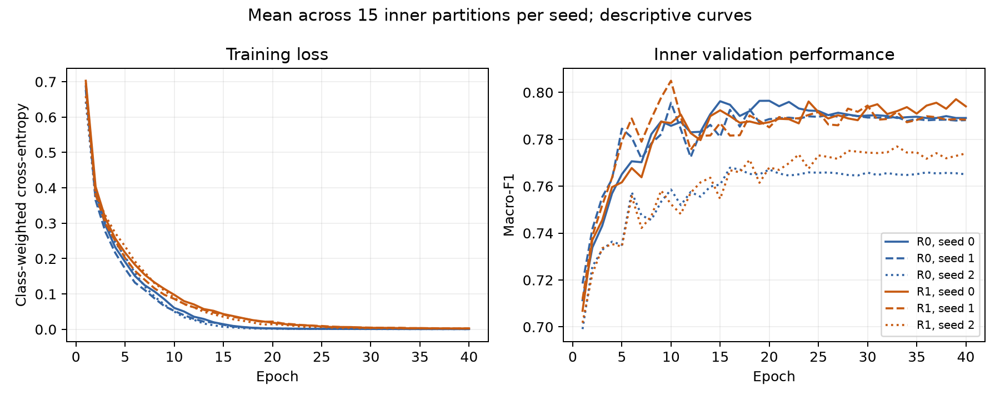

# ECGData LFCC–Swin regularization: completion review

Reviewed 23 October 2026. Training completed at **2026-10-16T04:32:18Z**
(00:32 EDT). All 90 inner fits and 30 outer trials finished without a recorded
training failure. Nothing remains to train for this frozen protocol.

## Outcome

The predeclared inner-selected procedure improved the window-accuracy point
estimate from **83.35% to 84.12%**. Its primary window macro-F1 difference was
**+0.0093**, with a paired 95% patient-bootstrap interval **[-0.0023, +0.0212]**.
The interval includes zero, so the primary comparison does not establish an
improvement. Preserve the original as the reference result and retain this study.

| Pipeline | Window accuracy | Window macro-F1 | Patient-vote accuracy |
|---|---:|---:|---:|
| Original LFCC–Swin, epoch 40 | 83.35% | 0.8006 | 94.17% |
| R0: inner-selected epoch | 83.46% | 0.8012 | 93.75% |
| R1: dropout 0.1 + inner-selected epoch | 84.49% | 0.8144 | 95.83% |
| Predeclared inner-selected procedure | 84.12% | 0.8099 | 94.58% |
| Pooled LFCC + logistic regression | 76.48% | 0.7342 | 87.50% |

All Swin rows average seeds **0, 1, 2**, with unchanged five patient-separated
outer folds and all 1,620 windows from 80 patients. These are seed means, not
ensembles. Patient voting combines windows and leads and has a different unit
of prediction from window accuracy. Every seed is in the [frozen report](report.md)
and [metric export](metrics.csv).

The dropout arm is encouraging secondary evidence: its window macro-F1
difference from v1 is +0.0139, interval [0.0032, 0.0251]; window-accuracy
difference is +1.13 percentage points, interval [+0.31, +2.00]. These intervals
are pointwise without multiplicity correction. The primary selected procedure
used R1 in folds 0/2/3 and R0 in folds 1/4. Replacing that procedure with the
highest outer-scoring arm after seeing these results would change the analysis.

## What changed and what remains difficult

R0 chose epochs 20/10/20/20/20, while R1 chose 40/10/40/40/40. Thus none of the
outer R0 choices matched the completed v1 epoch-40 models; all 30 outer trials
required new fitting. The 40-epoch cosine schedule horizon was preserved for
every early-stopped fit. Normalization and class weights used only each fit's
training patients. All inner selections were fixed before new outer evaluation.

| Pipeline | ARR window recall | CHF window recall | NSR window recall |
|---|---:|---:|---:|
| Original v1 | 88.82% | 72.00% | 78.24% |
| R0 | 88.65% | 72.33% | 78.89% |
| R1 | 89.44% | 75.00% | 79.17% |
| Inner-selected procedure | 89.10% | 74.56% | 78.80% |

These class summaries are descriptive means over all seeds. CHF remains the
weakest class, with only 15 patients. Mean outer-fit training accuracy remained
99.71% for R0 and 99.51% for R1, so the training/held-out gap remains large.
Epoch selection and this dropout setting produced modest changes rather than
removing the generalization problem.

The curves average 15 inner partitions per seed. They are descriptive and are
not outer-test learning curves; the reported selection pooled inner predictions
before calculating macro-F1 rather than averaging these plotted fold metrics.

## Evidence and scope

The workflow saved **4,380 epoch-history rows**, **300 retained candidate/final
prediction sets**, and **14,580 exported outer-prediction rows** (R0, R1 and the
selected procedure across three seeds). Sum of fit runtimes was **3,017.977 s**
(50.3 minutes), including fit-level checkpoint/reload checks and excluding global
preflight/reporting. All candidate/final weights were reloaded during execution;
the later review uses saved artifacts and predictions without new inference.

The October 23 audit passed: **1,887 v2 artifact entries**, **472 protected
original files**, **10 current sources and their snapshots**, and **8 report
exports** verified. Independent calculations reproduced the patient splits,
training-only statistics, all candidate selections, per-seed window/patient
metrics and exported predictions. These are engineering checks, not proof of
bug-free software. The first audit invocation reached the export step but could
not write through the sandbox's differently capitalized workspace path; the
approved rerun saved the audit and figures successfully.

- [Completion audit](completion_audit_2026-10-23.json) and [reproducible audit script](../../scripts/audit_ecgdata_regularization.py)
- [Artifact inventory](artifact_inventory.csv), [full analysis and uncertainty](analysis.json)
- [Patient splits](splits.csv), [candidate selections](selection.csv), [histories](histories.csv), [runtimes](fits.csv), [predictions](predictions.csv)
- [Frozen protocol](../../ecgdata_regularization_protocol_v2.md), [execution log](execution.log), [GPU preflight](gpu_preflight.json)

Intervals use 2,000 paired patient-bootstrap draws (seed 20260925), with seed
averaging inside each draw. They condition on saved predictions and omit
retraining/model-selection uncertainty. This repeatedly studied cohort confounds
diagnosis with source database; nested selection does not create untouched
external validation. These results do not establish clinical effectiveness.

Representation/raw-waveform comparisons, longer windows and additional-patient
studies remain unrun follow-ups. No further tuning was chosen or started from
these outer predictions. Large model/feature files remain local and gitignored;
committing these reports does not back up those binaries.
